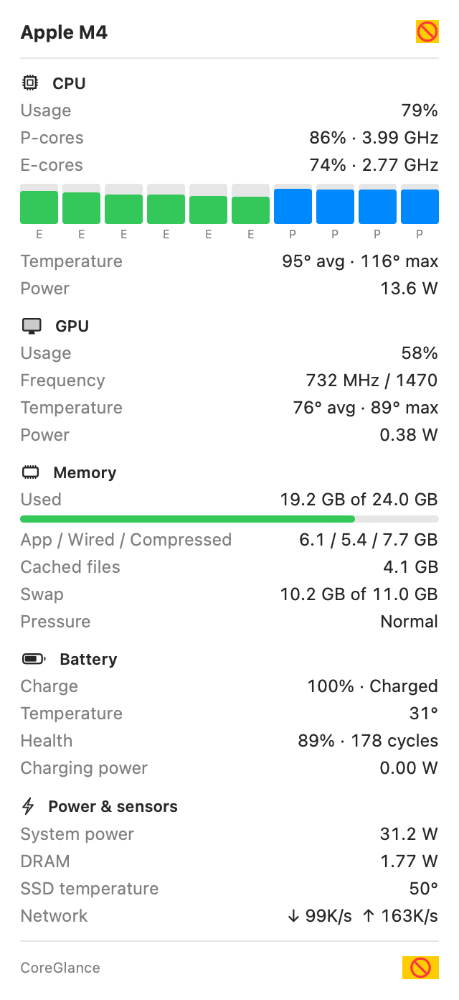

# CoreGlance

A tiny, dependency-free macOS menu bar monitor for Apple Silicon (M1–M4) with best-effort Intel support.


Click the item for the full readout:



## What it shows

| Metric | Menu bar | Popover | Source |
|---|---|---|---|
| CPU usage | ✓ | total, P-cores, E-cores, per-core bars | `host_processor_info` + device-tree `cluster-type` |
| CPU frequency | ✓ (P-cluster GHz) | P and E cluster GHz | IOReport DVFS residency × `pmgr` frequency tables |
| GPU usage / frequency | ✓ | usage, MHz | IOAccelerator `PerformanceStatistics`, IOReport `GPUPH` |
| Memory | ✓ (GB or %) | used, app/wired/compressed, cache, swap, pressure | `host_statistics64`, `vm.swapusage` |
| CPU / GPU temperature | ✓ | average + max | SMC `Tp*`/`Te*` and `Tg*` sensors |
| **Battery temperature** | ✓ | ✓ | AppleSmartBattery `Temperature`, SMC `TB*T` fallback |
| Battery | ✓ | charge, state, health, cycles, charge/discharge power | AppleSmartBattery |
| Power | ✓ (system W) | CPU, GPU, ANE, DRAM, whole system | IOReport Energy Model, SMC `PSTR` |
| Network | ✓ | down / up | `getifaddrs` |
| SSD temperature, fans | | ✓ when present | SMC |

Everything is configurable in the popover's settings (gear icon): which metrics appear in the menu bar, glyphs on/off, °C/°F, memory as GB or percent, refresh interval, launch at login.

## Design goals

- **No dependencies.** Swift Package Manager, AppKit + SwiftUI, IOKit. No Xcode project, no third-party code.
- **No root, no helper, no kernel extension.** Everything is read through public or user-accessible IOKit interfaces.
- **Robust.** Private interfaces (libIOReport) are loaded with `dlopen`. If a symbol or sensor disappears in a future macOS, that metric shows "–" and the rest keeps working. Sensors are discovered at runtime rather than hard-coded per chip.
- **Light.** One background timer, about 1 ms of work per tick.

## Install

Requirements: macOS 13 Ventura or newer. Building needs the Xcode command line tools.

```sh
git clone https://github.com/<you>/CoreGlance.git
cd CoreGlance
scripts/build-app.sh --install    # universal arm64 + x86_64 build, copied to /Applications
open /Applications/CoreGlance.app
```

The app is ad-hoc signed. If you download a release build instead of building it yourself, macOS may quarantine it. In that case, right-click the app and choose **Open**, or run `xattr -dr com.apple.quarantine /Applications/CoreGlance.app`.

## Troubleshooting

`CoreGlance --dump` prints every sensor the app can see. Please attach that output to bug reports:

```sh
/Applications/CoreGlance.app/Contents/MacOS/CoreGlance --dump
```

`--snapshot <folder>` renders the menu bar item and popover to PNG files.

## Platform notes

- **Apple Silicon M1–M4:** full support. M4 stores CPU DVFS tables in kHz instead of Hz; this is detected automatically.
- **M5 and newer, Pro/Max/Ultra:** P/E detection, usage, temperatures, power and battery work generically. The cluster frequency tables may use different `voltage-states` keys on newer chips, so please send a `--dump` if frequencies show "–".
- **Intel:** CPU/GPU usage, memory, battery, SMC temperatures and fans work. Live CPU frequency isn't available without a kernel driver, so the popover shows the base frequency.

See [RESEARCH.md](RESEARCH.md) for how each value is obtained and the caveats.

## License

MIT
