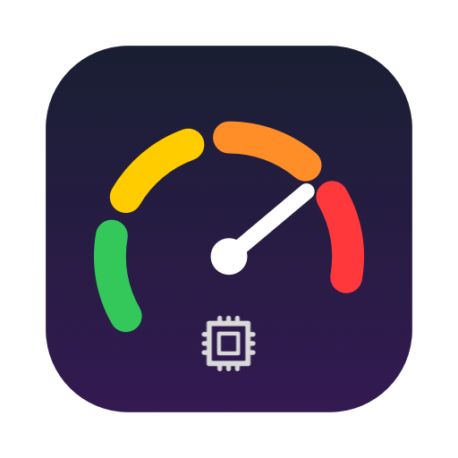
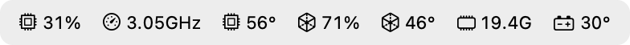
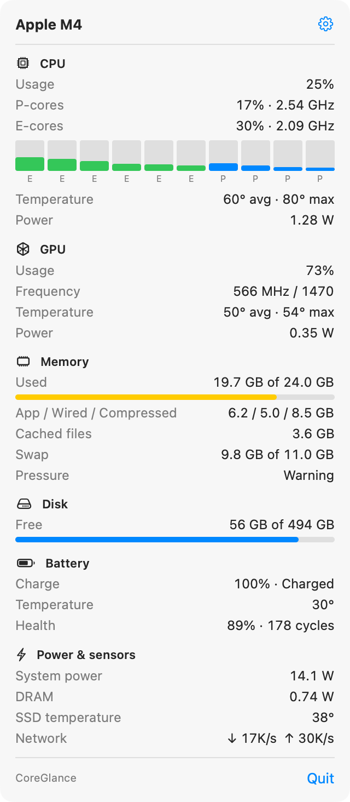
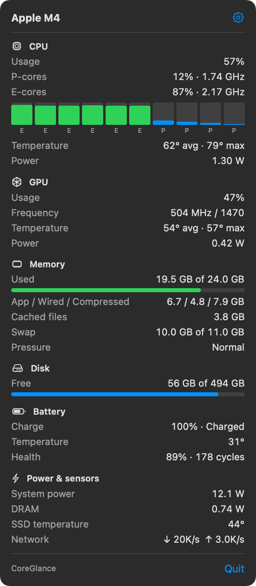
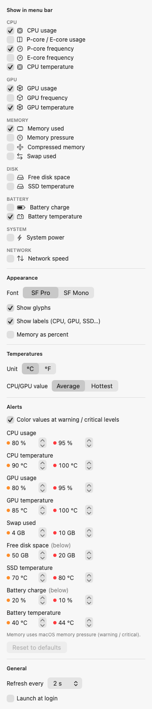

<p align="center">
  
</p>

<h1 align="center">CoreGlance</h1>

<p align="center">
  <b>A tiny, dependency-free system monitor for the macOS menu bar.</b><br>
  CPU (P/E cores + GHz), GPU, memory, disk, CPU/GPU/<b>battery temperatures</b> and power, at a glance.
</p>

<p align="center">
  <a href="https://github.com/TheMartas29/CoreGlance/actions/workflows/build.yml"></a>
  <a href="https://github.com/TheMartas29/CoreGlance/releases/latest"></a>
  
  
  
  <a href="LICENSE"></a>
</p>

<p align="center">
  <picture>
    <source media="(prefers-color-scheme: dark)" srcset="docs/menubar-dark.png">
    
  </picture>
</p>

<p align="center">
  
  &nbsp;&nbsp;
  
</p>

<details>
<summary><b>Settings</b></summary>
<p align="center"></p>
</details>

---

## Why

Most menu bar monitors either pull in a pile of frameworks, need a privileged helper, or skip the numbers that matter on a fanless MacBook, such as **battery temperature** and **real P/E-core clock speeds**. CoreGlance is one small native app that reads everything directly from macOS. It needs no root, no kernel extension, no helper tool and no network access.

## Features

- **CPU:** total usage, **P-core vs E-core usage**, per-core bars, and **live cluster frequency in GHz**, calculated the same way as MX Power Gadget.
- **GPU:** usage, live frequency, temperature and power.
- **Memory:** used (GB or %), app / wired / **compressed**, **swap**, memory pressure. These show how far you are overflowing physical RAM.
- **Disk:** free space on the boot volume.
- **Temperatures:** CPU, GPU, **battery**, SSD. You can show the average or the hottest sensor.
- **Battery:** charge, charging state, time remaining, health, cycle count, charge/discharge power.
- **Power:** whole-system watts, CPU, GPU, Neural Engine and DRAM power.
- **Network** down/up speed, and **fan speed** on Macs that have fans.
- **Temperature alerts:** CPU, GPU, battery and SSD temperatures turn orange or red at warning and critical levels. The defaults are [researched](RESEARCH.md#alert-thresholds) and can be adjusted.
- **Fully configurable menu bar:** pick any combination of 19 metrics (only the ones your Mac can actually read are offered), with SF Symbol glyphs, optional labels, and SF Pro or SF Mono font.
- **Native and light:** AppKit + SwiftUI, a ~1 MB universal binary, one background timer, light and dark mode, launch at login.

## Install

### Download (recommended)

1. Download `CoreGlance.zip` from the [latest release](https://github.com/TheMartas29/CoreGlance/releases/latest) and unzip it.
2. Move **CoreGlance.app** to **/Applications**.
3. **First launch:** the app is open source and not notarized by Apple, so macOS blocks a plain double-click. Use one of these:
   - Right-click (or Control-click) the app, choose **Open**, then confirm **Open**.
   - On macOS 15 and later, if that option is missing: try to open the app once, then go to **System Settings → Privacy & Security** and click **Open Anyway**.
   - Or remove the quarantine flag in Terminal:
     ```sh
     xattr -dr com.apple.quarantine /Applications/CoreGlance.app
     ```
4. The meters appear in the menu bar. CoreGlance has no Dock icon; click the menu bar item to open it.

### Build from source

You need macOS 13+ and the Xcode Command Line Tools (`xcode-select --install`). Full Xcode is not required.

```sh
git clone https://github.com/TheMartas29/CoreGlance.git
cd CoreGlance
scripts/build-app.sh --install      # universal arm64 + x86_64 build → /Applications
open /Applications/CoreGlance.app
```

To work on the code, `swift build && .build/debug/CoreGlance` runs it straight from the package.

### Update and uninstall

- **Update:** replace the app in /Applications with the new version.
- **Uninstall:** quit CoreGlance (popover → **Quit**) and delete the app. Settings live in `~/Library/Preferences/io.github.coreglance.plist`.

## Usage

- **Click** the menu bar item to see every reading.
- Click the **gear** to choose what is shown in the menu bar, plus font, glyphs, labels, units, temperature mode, alert levels, refresh rate and launch at login.
- **⌘-drag** the item to move it within the menu bar (standard macOS behaviour).

## Compatibility

Requires **macOS 13 Ventura or newer** (developed and verified on macOS 26).

| Mac | Usage | P/E split | CPU GHz | GPU MHz | CPU/GPU temp | Battery temp | Power |
|---|:-:|:-:|:-:|:-:|:-:|:-:|:-:|
| **M4** (base) | ✅ | ✅ | ✅ | ✅ | ✅ | ✅ | ✅ |
| M4 Pro / Max | ✅ | ✅ | 🟡 | 🟡 | 🟡 | ✅ | 🟡 |
| M3 · M3 Pro / Max | ✅ | ✅ | 🟡 | 🟡 | 🟡 | ✅ | 🟡 |
| M2 · M2 Pro / Max / Ultra | ✅ | ✅ | 🟡 | 🟡 | 🟡 | ✅ | 🟡 |
| M1 · M1 Pro / Max / Ultra | ✅ | ✅ | 🟡 | 🟡 | 🟡 | ✅ | 🟡 |
| M5 and newer | ✅ | 🟡 | ⚠️ | ⚠️ | 🟡 | ✅ | 🟡 |
| Intel Macs | ✅ | – | base clock only | – | ✅ | ✅ | ⚠️ |

- ✅ means verified on real hardware.
- 🟡 means expected to work: the same interfaces and the logic used by [macmon](https://github.com/vladkens/macmon) and [Stats](https://github.com/exelban/stats), but not yet confirmed by a CoreGlance user.
- ⚠️ means limited. A value that can't be read shows "–" and the rest of the app keeps working.
- Battery rows apply to MacBooks only. Desktop Macs have no battery, and fan speed appears only on Macs with fans.

**Tested on a different Mac?** Please [open a compatibility report](https://github.com/TheMartas29/CoreGlance/issues/new?template=compatibility.yml) with the output of `--dump` (see below) so this table can be updated.

### Known limitations

- **Intel:** live CPU frequency needs a kernel driver (Intel Power Gadget is discontinued), so only the base clock is shown.
- **macOS 27:** Apple is reportedly restricting the IOReport *energy* counters behind a private entitlement. If that happens, the per-component watts stop updating, while frequencies, temperatures and system power keep working.
- **Gatekeeper:** builds are ad-hoc signed, not notarized (see *First launch* above).

## How it works

Every value comes from an interface a normal user process may read:

| Data | Source |
|---|---|
| CPU usage per core | `host_processor_info` (Mach) |
| P/E core mapping | device tree `cpus/cpuN` → `cluster-type` |
| CPU/GPU frequency | IOReport DVFS residencies × `pmgr` voltage-state tables |
| CPU/GPU/ANE/DRAM power | IOReport *Energy Model* |
| Temperatures, fans, system power | SMC (`AppleSMC` user client), sensors discovered at runtime |
| GPU usage | `IOAccelerator` → `PerformanceStatistics` |
| Memory, swap, pressure | `host_statistics64`, `vm.swapusage`, `kern.memorystatus_vm_pressure_level` |
| Battery | `AppleSmartBattery` (IORegistry) |
| Disk | `volumeAvailableCapacityForImportantUsage` (same as Finder) |

The private `libIOReport` is loaded with `dlopen`, so a missing symbol degrades gracefully instead of crashing. [RESEARCH.md](RESEARCH.md) has the details: units, M4 quirks, sensor naming and what was verified.

### Privacy

CoreGlance makes **no network connections** and collects nothing. The network meter only reads interface byte counters.

## Troubleshooting

Print everything CoreGlance can see. This is the most useful thing to attach to an issue:

```sh
/Applications/CoreGlance.app/Contents/MacOS/CoreGlance --dump
```

| Problem | Fix |
|---|---|
| "CoreGlance can't be opened" | See *First launch* above. |
| Item is not in the menu bar | On notched MacBooks a crowded menu bar hides items behind the notch. Turn off some metrics or remove other menu bar apps. |
| A value shows "–" | That sensor isn't available on your Mac. Please send a `--dump`. |
| Launch at login doesn't stick | Make sure the app is in /Applications, then toggle the setting again. |

## Project structure

```
Sources/CoreGlance/
  Sensors/      SMC, IOReport, CPU load, SoC frequency/power, thermals, memory/GPU/battery/network/disk
  UI/           menu bar renderer, popover, settings
  Monitor.swift background polling → snapshots
scripts/        build-app.sh (bundle + sign), make-icon.swift
```

## Contributing

Issues and pull requests are welcome, especially compatibility reports from M1–M3, Pro/Max/Ultra, M5 and Intel Macs. See [CONTRIBUTING.md](CONTRIBUTING.md).

## Acknowledgements

Research and inspiration: [macmon](https://github.com/vladkens/macmon), [Stats](https://github.com/exelban/stats), [eul](https://github.com/gao-sun/eul), [Hot](https://github.com/macmade/hot), [asitop](https://github.com/tlkh/asitop), [socpowerbud](https://github.com/dehydratedpotato/socpowerbud) and [MX Power Gadget](https://www.seense.com/menubarstats/mxpg/). No code was copied; CoreGlance is an independent implementation.

## License

[MIT](LICENSE) © Roman Martinek
